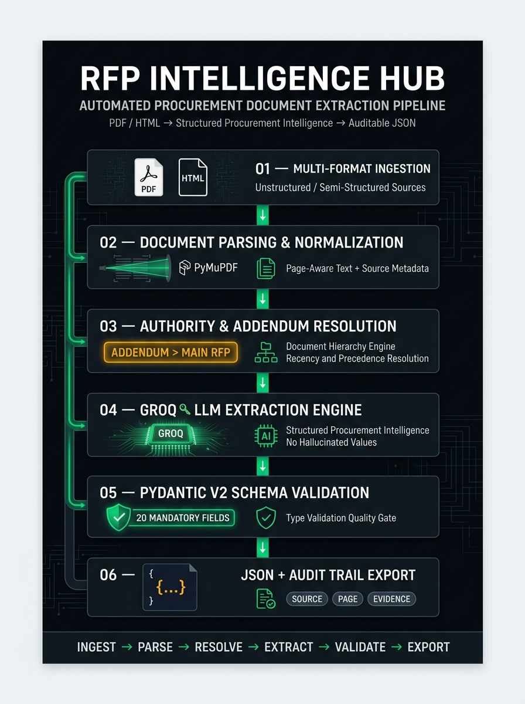

# Architecture Overview

<p align="center">
  
</p>

---

## 1. System Philosophy
The **RFP Intelligence Extractor** is built on the engineering principle that robust information extraction from heterogeneous, real-world procurement packages requires more than a simple `PDF -> LLM -> JSON` prompt. Procurement packages consist of multi-document bundles:
- Original formal solicitations (RFPs/PORFPs)
- Subsequent legal amendments/addenda that modify critical terms (e.g. deadline extensions, scope clarifications)
- Technical specification sheets and catalogs
- Mandatory statutory compliance affidavits
- Web portal summary captures (e.g. BidNet Direct, eMMA)

To guarantee high extraction precision, verifiable provenance, and zero unsupported claims, the pipeline decouples ingestion, structural parsing, document relationship discovery, contextual chunking, structured extraction, Pydantic validation, conflict resolution, and evidence tracking.

---

## 2. End-to-End Pipeline Dataflow

```
   ┌────────────────────────────────────────────────────────┐
   │        Raw Ingestion Layer (PDFs, HTML Web Portals)     │
   └───────────────────────────┬────────────────────────────┘
                               │
                               ▼
   ┌────────────────────────────────────────────────────────┐
   │            File Format Detection & Dispatcher          │
   └───────────────┬────────────────────────┬───────────────┘
                   │                        │
                   ▼                        ▼
      ┌───────────────────────┐  ┌───────────────────────┐
      │  PDFParser (PyMuPDF)  │  │ HTMLParser (bs4/lxml) │
      │  - Page-by-page text  │  │ - Boilerplate removal │
      │  - Spatial ordering   │  │ - Key-value tables    │
      │  - Layout preservation│  │ - Form-wrapper safety │
      └───────────┬───────────┘  └───────────┬───────────┘
                  │                          │
                  └────────────┬─────────────┘
                               │
                               ▼
   ┌────────────────────────────────────────────────────────┐
   │         DocumentGrouper & Precedence Classifier        │
   │  - Groups documents by procurement package / bid ID   │
   │  - Classifies legal roles & assigns authority weights: │
   │    • ADDENDUM (Weight 100 + sequence number)           │
   │    • MAIN_SOLICITATION (Weight 50)                     │
   │    • SPEC_SHEET (Weight 40)                            │
   │    • WEB_PORTAL (Weight 30)                            │
   │    • AFFIDAVIT (Weight 20)                             │
   └───────────────────────────┬────────────────────────────┘
                               │
                               ▼
   ┌────────────────────────────────────────────────────────┐
   │        DocumentChunker & Salience Selector             │
   │  - Preserves page numbers and section boundaries       │
   │  - Prioritizes schedule, scope, and specs sections     │
   └───────────────────────────┬────────────────────────────┘
                               │
                               ▼
   ┌────────────────────────────────────────────────────────┐
   │               LLM Extraction Service                   │
   │  - Multi-provider: Groq, OpenAI, Gemini, Anthropic, Mock │
   │  - Strict system prompt with 20 field definitions      │
   │  - Zero-hallucination & missing-information rules      │
   └───────────────────────────┬────────────────────────────┘
                               │
                               ▼
   ┌────────────────────────────────────────────────────────┐
   │            StructuredOutputParser & Candidates         │
   │  - Extracts candidate fields with document provenance  │
   │  - Captures verbatim text snippets for audit tracking  │
   └───────────────────────────┬────────────────────────────┘
                               │
                               ▼
   ┌────────────────────────────────────────────────────────┐
   │            ConflictResolver (Addendum-Aware)           │
   │  - Detects conflicting candidate values across docs    │
   │  - Enforces authoritative addendum precedence          │
   │  - Logs resolution reasoning & previous candidate      │
   └───────────────────────────┬────────────────────────────┘
                               │
                               ▼
   ┌────────────────────────────────────────────────────────┐
   │       Pydantic v2 Validation & Normalization           │
   │  - Mandates all 20 required fields                     │
   │  - Normalizes dates, preserving time & timezone        │
   │  - Enforces 'Not Specified' strategy for absent data   │
   │  - Flags hallucination tokens & extraneous keys        │
   └───────────────────────────┬────────────────────────────┘
                               │
                               ▼
   ┌────────────────────────────────────────────────────────┐
   │               Output & Traceability Export             │
   │  - data/output/<bid>.json       (Clean 20-field JSON)  │
   │  - data/output/<bid>_audit.json (Extended provenance)  │
   └────────────────────────────────────────────────────────┘
```

---

## 3. Key Components & Responsibilities

### 1. Parsing Layer (`src/parser/`)
- **`BaseParser`**: Interface defining `ParsedDocument` and `DocumentPage` data transfer objects.
- **`PDFParser`**: High-performance text and layout extraction utilizing `pymupdf` (fitz) with automatic fallback to `pypdf`. Extracts pages independently, cleans non-printable ASCII control characters, and handles empty pages safely.
- **`HTMLParser`**: Uses BeautifulSoup4 to strip navigational elements, banners, scripts, and styles while preserving ASP.NET `<form>` elements and extracting definition lists and key-value tables into machine-readable format.

### 2. Processing & Grouping (`src/processing/`)
- **`DocumentGrouper`**: Detects package relationships through directory hierarchy and shared procurement IDs. Computes document legal authority weights (Addenda > Main RFP > Specs > Web > Affidavits).
- **`DocumentChunker`**: Section-aware text chunker that tracks document provenance, page numbers, and headings. Prevents token overflow while preserving critical procurement terms.
- **`ConflictResolver`**: Evaluates all candidate values across documents. Detects clashes (e.g., original RFP submission date vs. Addendum 2 extension) and resolves them deterministically using document legal hierarchy.
- **`Normalizer`**: Standardizes text and formats date strings without stripping vital procurement constraints such as time of day or timezone.

### 3. Extraction & Validation (`src/extraction/`, `src/validation/`, `src/schema/`)
- **`RFPExtractionRecord`**: Pydantic v2 schema enforcing all 20 mandatory procurement fields.
- **`ExtractionValidator`**: Verifies that every required key exists, no extraneous keys are present, and no hallucinated placeholders slipped through.
- **`BaseLLMExtractor`**: Multi-provider client abstraction supporting Groq (LPU JSON mode), OpenAI (JSON mode), Google Gemini (structured response mime), Anthropic Claude, and a deterministic `MockLLMExtractor` for zero-cost testing.
